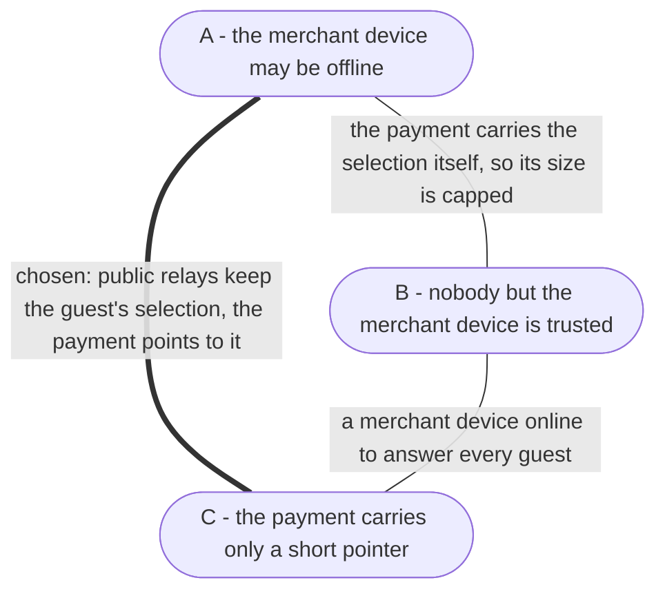
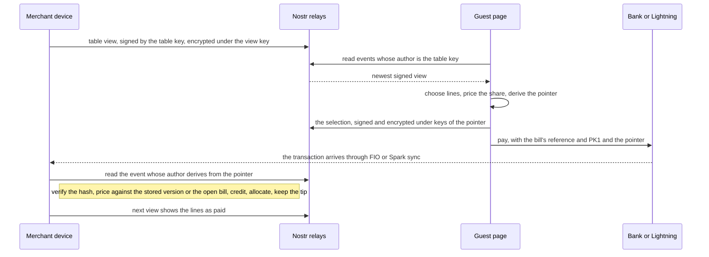

# Table self-pay design

A guest scans the QR sticker on a table, sees the bill and pays their share by
bank transfer or Lightning. This document says why it is built the way it is:
which properties we chose and which we gave up. Each decision links its record,
which says when to revisit it. How the merchant device records the money is in
[payment-sync.md](payment-sync.md#table-self-pay), and how a self-pay payment
affects a bill is in
[bill-payment-states.md](bill-payment-states.md#self-pay-payments).

## The problem

A sticker hands keys to strangers. Whoever scans it is anonymous, and a photo
of it works from anywhere, for as long as the sticker stays on the table. So
every guest is a potential attacker, and the design has to hold against three
things a stranger with the sticker could try:

- **Forge.** Show other guests a bill that is not the merchant device's, or
  make the merchant device believe lines are paid when they are not.
- **Flood.** Make a merchant device or anything it depends on store, decrypt
  or look up data for every request a stranger sends.
- **Misallocate.** Take credit for someone else's payment, or attach a
  selection to money the attacker did not send.

The merchant device runs Payky on low-end Android or as a PWA in a restaurant.
It loses Wi-Fi, it is off for the night, and a transfer a guest sends from
home tomorrow must still land. There is no Payky server, and none should be
needed.

The same path carries orders from the menu
([menu-ordering/0001](decisions/menu-ordering/0001-guests-order-from-a-published-menu-and-a-paid-order-is-a-bill.md)).
Finito carried guest messages as nostr RPC (kind 23195, NIP-04), and public
relays banned that traffic over time.

## The trilemma

We want three properties, and every channel design we examined delivers only
two of them:

- **A** - the merchant device may be offline when the guest pays.
- **B** - nobody but the merchant device is trusted. No operator, no service
  that must behave.
- **C** - the payment carries only a short pointer.

Every edge is one family of designs, and its hole is the vertex it misses:

| Edge | Design | Hole |
|---|---|---|
| A + C | a mailbox keeps the guest's selection until a merchant device picks it up, the payment names it with a short pointer | a mailbox that must stay online, and that any sticker holder can flood |
| A + B | the payment carries the guest's selection, relative to the view the guest saw | a long code, so the selection has a size limit and carries no order |
| B + C | the merchant device answers the guest and hands out a short reference | a merchant device must be online, and every guest request is work for a merchant device |

We take **A + C**, with public relays as the mailbox, and B holds with one
weaker word: relays are trusted to keep the guest's event, never to tell the
truth about it. The event verifies itself (decision 3), and no merchant
device reads a guest's event unless money arrived that names it, so flood
protection is the absence of an endpoint on the merchant device, not a rate
limit to tune. Any relay that keeps the event will do, and one that loses it
loses only the lines a payment marks paid, never the money. A is not
negotiable for a restaurant phone, and A + B caps a selection at about 60
lines and carries no order.

## Proof instead of permission

The usual answer to untrusted senders is to guard an inbound channel:
authentication, quotas, proof of work, bans. We go at it from the other side.
There is no inbound channel to guard. Every input that reaches the merchant
device carries its own proof, and anything without one is ignored:

| Input | Proof | Who can produce it |
|---|---|---|
| The view a guest reads | a signature by the table's key | only the merchant's devices |
| The money | it arrived on the merchant's own account, seen by the merchant device's FIO or Spark sync | anyone, at the price of the money |
| The selection a payment points to | its content hashes to the pointer, and it is signed and encrypted under keys derived from the pointer and the account's selection key | only someone holding both the pointer and a sticker of the merchant, which is the payer |
| The Lightning rate | an 80-bit MAC under a key derived from the merchant's master key | only the merchant's devices |

No arrow leads from the guest to the merchant device. The one event a guest
writes is read only after money arrived that names it, and only if it hashes
to what the money names. That is the whole security argument, and the
decisions below keep it true.

## What a stranger can send, and what it costs the merchant device

| A stranger | Merchant device work | Stranger's cost |
|---|---|---|
| opens the guest page a thousand times | none, the page reads relays | nothing |
| posts junk events for the table | none, guests filter by author and the merchant device reads no guest events | nothing, and nobody sees them |
| publishes selections without paying | none, a selection is looked up only for money that names it | nothing, and the relays carry it |
| floods a relay after seeing a guest's selection | none, the merchant device asks only for the pointer's own author, which nobody else can sign as | nothing gained |
| pays with a garbage or foreign pointer | one parse of at most 140 characters and one relay query, repeated for 10 minutes | the money, which the merchant keeps |
| sends a thousand payments of one satoshi | one parse each, no payment because each credit is below the self-pay minimum and short of what the bill still owes | a thousand Lightning payments |
| shows staff a faked success screen | none, staff sees only arrived money | nothing gained |

Every row that costs a merchant device work also costs the stranger a real
payment to the merchant. The rails have already priced every message.

## Decisions

### 1. A guest publishes the selection, and the payment points to it

Why: a pointer is short enough for any bank message, and what it points to
holds any selection, an order or a note for the kitchen. The merchant device
has no endpoint a stranger can reach.

Recorded in [table-self-pay/0020](decisions/table-self-pay/0020-a-payment-points-to-a-selection-the-guest-published.md).

### 2. The merchant device signs what guests read

Why: relays become interchangeable, untrusted carriers. One can withhold a
view but cannot forge, bury or roll it back, and a guest only needs one honest
relay.

The merchant can switch a default relay off or add one of their own, and a
sticker names its relays only when they differ from the defaults
([table-self-pay/0003](decisions/table-self-pay/0003-the-merchant-picks-the-relays-tables-publish-to.md)).

A sticker copied with relays of its own reads only those, which can offer an
old view. Each confirmation names the view it confirms, so the page warns
about an older one at most ten minutes after the bill changed
([table-self-pay/0014](decisions/table-self-pay/0014-a-confirmation-counts-only-for-the-view-it-names.md)).

Recorded in [table-self-pay/0004](decisions/table-self-pay/0004-the-merchant-device-signs-what-guests-read.md), with when to revisit.

### 3. The payment names the selection with a pointer

The guest page writes the selection as JSON with 16 random bytes, and the
pointer is the first 160 bits of SHA-256 over it, 32 base32 characters
(`deriveSelfPayPointer`). The selection names the bill's reference, the
version of the bill the guest saw and the split: lines with a share each,
lines with one common share, the rest of the bill, 1/N of the bill, or an
amount. A seed derived from the pointer and the account's selection key, which
every table's view carries, gives the key that signs the event and the key
that encrypts it (`deriveSelfPayPointerKeys`). The page shows how to pay once
the first relay accepted the event (`publishSelfPaySelection`).

Why: only the payer holds both the pointer and a sticker's view, so only the
payer can publish or read under the pointer. A bank or Lightning operator that
sees the message has the pointer alone. A selection changed in any way no
longer hashes to the pointer, and two selections under one pointer cost about
2^80 work and count as none.

A merchant device that finds no selection keeps asking for 10 minutes after
it first saw the money, at 1, 3, 6 and 11 minutes (`self-pay-pointer-job.ts`),
and then counts the money without lines. A device that found it has written
its rows by then, so two devices agree (decision 4).

Recorded in [table-self-pay/0020](decisions/table-self-pay/0020-a-payment-points-to-a-selection-the-guest-published.md).

### 4. The merchant device believes only what it can recompute

| The payment claims | The merchant device checks | When the check fails |
|---|---|---|
| which bill | the reference names exactly one bill that is open, or closed or canceled at most 7 days before the money arrived, the bill has a device, a bank transfer is in the bill's currency, and a Lightning rate was signed for it | the money stays unmatched for staff |
| how much | the credit is the money that arrived. On Lightning it is the lower of the stated amount and the sats at the signed rate (`loadLightningArrival`) | the guest cannot claim more than they paid |
| the rate | its MAC, the invoice's own time inside the rate's hour, and the money arriving at most 10 minutes after it | the money stays unmatched |
| which lines | the selection the pointer names hashes to the pointer, names this bill, and its version is one this merchant device stored or, while the bill is open on its table, the bill as it stands | the money counts without paying lines |
| the share | the merchant device prices it with `calculateSelfPayShare`, the function the page used. A fraction rounds down, and the lines of a share, a fraction of the bill included, round once together ([table-self-pay/0016](decisions/table-self-pay/0016-a-self-pay-share-rounds-down-once-for-all-of-its-lines.md)). A share that would leave the bill less than the minimum, or a typed amount above what it owes, is the whole remainder. A credit below the share pays no lines (`allocateSelfPaySelection`) | the money counts without paying lines |
| a line's share | only lines the bill still has, each capped at what remained on it in the version the guest chose from (`remainingOnLine`) | that part pays no line |
| that it is worth recording | the self-pay minimum, 1.00 CZK, 0.05 EUR or 0.05 USD, or everything the bill still owes (`meetsSelfPayMinimum`, [table-self-pay/0011](decisions/table-self-pay/0011-self-pay-starts-at-about-one-koruna-or-everything-left.md)) | the money stays unmatched |

Recorded in [table-self-pay/0005](decisions/table-self-pay/0005-the-merchant-device-believes-only-what-it-can-recompute.md).

### 5. Only the view is limited in size

The payment carries `PK1` and the pointer: 35 characters in the bank message,
one line of a Czech interbank message and well inside the 60 QR Platba allows
([standard](https://qr-platba.cz/wp-content/uploads/QR_platba_standard_CBA.pdf)),
and at most 108 of the 120 bytes Spark allows for the Lightning description
([docs](https://docs.spark.money/wallets/deposit-from-lightning)),
`PK1 <reference> <pointer> A<amount> R<msat per unit>.<valid from>.<MAC>`.
The parser still rejects a bank message over 140 characters or a description
over 120 before it reads them (`table-self-pay-reference-utils.ts`).

The view must fit one relay event: past 60 KiB of encrypted content the bills
with the most lines are listed by their totals, and then the newest bills are
left out.

Recorded in [table-self-pay/0021](decisions/table-self-pay/0021-only-the-view-is-limited-in-size.md).

### 6. Lightning works for an hour without a merchant device online

Recorded in [table-self-pay/0006](decisions/table-self-pay/0006-lightning-works-for-an-hour-without-a-merchant-device.md), with when to revisit.

### 7. Nothing is reserved

Why: a reservation is a write a stranger can trigger without paying, which is
exactly the flood this design removes. An overpayment is rare, visible, and
handled by staff the same way as at the counter.

Recorded in [table-self-pay/0007](decisions/table-self-pay/0007-nothing-is-reserved.md), with when to revisit.

## What we accept

- A bank that cuts the message, or relays that lose the selection, turn the
  transfer into money toward the bill without lines paid, 10 minutes after it
  arrived when the pointer still parses. Staff sees it as any unallocated
  payment.
- When no relay accepts the selection, the guest can still pay the amount,
  which counts toward the bill without lines.
- Lightning needs a merchant device that was online within the last hour.
- A view changed after the guest looked is still priced against the stored
  version. A version only another merchant device published, and not yet
  synced, falls back to the bill as it stands while it is open on its table,
  and otherwise to no allocation.

## Ordering from the menu

An order is a selection too: menu items and quantities, the table and a note.
Its payment carries a reference that starts with 9, which no bill reference
does, and the device that takes orders records it as a bill of its own, priced
from the menu version the guest ordered from
([menu-ordering/0001](decisions/menu-ordering/0001-guests-order-from-a-published-menu-and-a-paid-order-is-a-bill.md),
[menu-ordering/0002](decisions/menu-ordering/0002-one-device-takes-orders.md)).
With bill paying switched off, a table's view lists no bill and names only the
menu, so a sticker reveals nothing about what the table ordered
([menu-ordering/0003](decisions/menu-ordering/0003-a-table-publishes-nothing-about-what-it-ordered.md)).